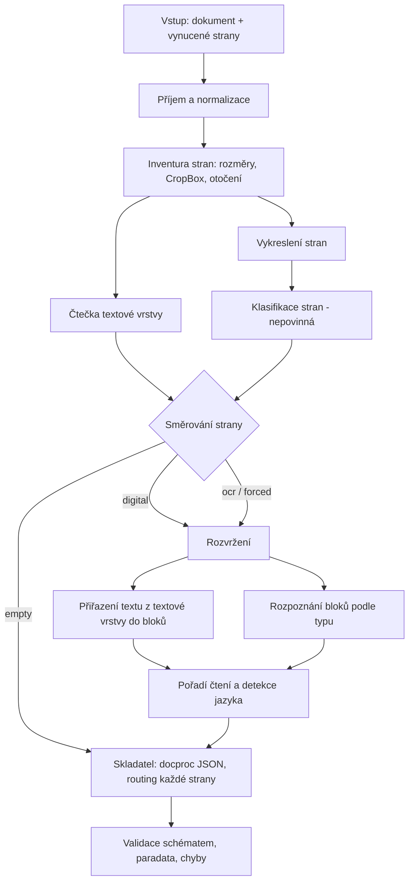

# Otevřená služba ATR: plán stavby

Stav: návrh k diskusi (17. 11. 2026). Zadání: [aiscr-atr#2](https://github.com/ARUP-CAS/aiscr-atr/issues/2), kontrakt výstupu: [aiscr-docs-pipeline#17](https://github.com/ARUP-CAS/aiscr-docs-pipeline/issues/17).

## 1. Cíl a zásady

- **Jeden vstup, jeden výstup.** Jakýkoli dokument (born-digital PDF, sken, smíšené PDF, obrázek) projde stejným rozhraním a vrátí `atr/docproc-json` podle schématu ARUP-CAS.
- **Vyměnitelné komponenty.** Každá část má pevné rozhraní a aspoň jednu implementaci. Výměna implementace je změna konfigurace, ne kódu potrubí.
- **Každá část samostatně.** Komponenta má vlastní testy a jde spustit z příkazové řádky nad jedním souborem. Potrubí je spojuje až nakonec.
- **Jen otevřené nástroje.** Kód i váhy s licencí MIT, Apache-2.0 nebo BSD. Nic se nepřebírá z proprietárních řešení.
- **Využít, co už v ATRIUM je.** Nástroje ÚFAL (MIT) se zapojí jako implementace komponent, kde se hodí.

## 2. Potrubí



Rozvržení běží stejným modelem na textových i skenovaných stranách. Liší se jen zdroj textu v bloku: textová vrstva, nebo rozpoznání.

## 3. Komponenty

| # | Komponenta | Vstup → výstup | První implementace | Další možnosti |
|---|---|---|---|---|
| 1 | **Příjem a normalizace** | soubor → PDF nebo sada stran, MIME, název a SHA-512 od orchestrace | PDF a obrázky | kancelářské formáty přes převod do PDF |
| 2 | **Inventura stran** | PDF → rozměry každé strany (CropBox, `/Rotate`, `UserUnit`), jednotný rám souřadnic | PDFium | pypdf |
| 3 | **Vykreslení stran** | strana → obrázek při zvoleném DPI | PDFium | – |
| 4 | **Čtečka textové vrstvy** | strana → znaky, slova a řádky s polohou | PDFium | `atrium-digital-convert` (ÚFAL), pdfplumber |
| 5 | **Verdikt textové vrstvy** | text strany → použitelná, vadná, žádná, starší OCR vrstva | pravidla nad podílem čitelných znaků a slov | jazykový model a skóre kvality z `atrium-ocr-postprocess` |
| 6 | **Klasifikace stran** (nepovinná) | obrázek strany → kategorie s jistotou | `ufal/vit-historical-page` z `atrium-page-classification` | SigLIP |
| 7 | **Směrování** | verdikt, vynucené strany, příp. kategorie → trasa `digital`, `ocr`, `forced`, `empty` s důvodem | pravidla v konfiguraci | – |
| 8 | **Rozvržení** | obrázek strany → bloky s typem, polohou, jistotou a pořadím | PP-DocLayoutV3 | Heron (Docling), DocLayout-YOLO |
| 9 | **Přiřazení textu** | slova z textové vrstvy + bloky → text bloku a řádky se změřenou polohou | překryv slov s bloky | – |
| 10 | **Rozpoznání bloků** | výřez bloku + typ → text, tabulka, vzorec | PaddleOCR-VL-1.6 za vLLM | GLM-OCR; samostatný rozpoznávač podle typu |
| 11 | **Pořadí čtení** | bloky → pořadí | z modelu rozvržení | geometrické pravidlo |
| 12 | **Detekce jazyka** | text bloku nebo strany → jazyk | fastText (jako v nástrojích ATRIUM) | – |
| 13 | **Skladatel** | strany a bloky → `atr/docproc-json` | vlastní | – |
| 14 | **Validace, chyby, paradata** | výstup → kontrola schématem, chybový model, data o běhu | vlastní | – |

Rozpoznání bloků (10) se volí podle typu z rozvržení. Tabulka typ → rozpoznávač je v konfiguraci: text, tabulka, vzorec a později rukopis mohou mít každý jiný model. Obrázky a kresby se nerozpoznávají, ve výstupu jsou jen polohou.

## 4. Jak je to vyměnitelné

- **Rozhraní:** každá komponenta je třída podle společného protokolu (vstupní a výstupní datové typy v jednom modulu).
- **Registr:** implementace se hlásí jménem. Konfigurace (YAML) říká, která se použije a s jakými parametry.
- **Vzdálené modely:** rozvržení a rozpoznávání jsou za HTTP rozhraním, aby šly provozovat na GPU zvlášť a vyměnit bez nového sestavení služby.
- **Paradata:** každá komponenta hlásí své jméno, verzi a parametry, takže výstup vždy říká, čím vznikl.

### Porty a adaptéry

Potrubí zná jen **porty**: pevná rozhraní s pevnými datovými typy. Konkrétní nástroj je **adaptér**, který port naplní. Nový model nebo knihovna znamená napsat adaptér a změnit řádek v konfiguraci. Tok potrubí se nemění.

| Port | Dotaz → odpověď | Kde běží adaptér |
|---|---|---|
| `PageSource` | soubor → strany s rozměry a rámem souřadnic | v procesu |
| `PageRenderer` | strana, DPI → obrázek | v procesu |
| `TextLayerReader` | strana → slova a řádky s polohou | v procesu |
| `TextLayerJudge` | text strany → verdikt | v procesu |
| `PageClassifier` | obrázek strany → kategorie, jistota | kontejner s modelem |
| `Router` | verdikt, vynucené strany, kategorie → trasa, důvod | v procesu |
| `LayoutDetector` | obrázek strany → bloky (typ, poloha, jistota, pořadí) | kontejner s modelem |
| `BlockRecognizer` | výřez, typ bloku → obsah | kontejner s modelem |
| `LanguageDetector` | text → jazyk, jistota | v procesu |
| `Assembler` | strany, bloky, trasy → docproc JSON | v procesu |

Každý kontejner s modelem má stejné minimum: `POST /predict` podle svého portu, `GET /info` (model, verze, licence) a `GET /health`. Rozpoznávače za vLLM mluví rozhraním kompatibilním s OpenAI; adaptér ho převádí na port `BlockRecognizer`.

### Rozložení repozitáře

```
aiscr-atr/
├── docker-compose.yml          # atr-api + kontejnery modelů
├── config/
│   └── pipeline.yaml           # který adaptér je na kterém portu, tabulka typ bloku → rozpoznávač
├── atr/                        # služba (CPU)
│   ├── api/                    # /convert, /info, /health
│   ├── pipeline/               # tok potrubí; zná jen porty
│   ├── ports/                  # rozhraní a datové typy
│   ├── adapters/
│   │   ├── page_source/pdfium/
│   │   ├── text_layer/pdfium/
│   │   ├── text_layer_judge/rules/
│   │   ├── router/rules/
│   │   ├── layout/http/        # klient kontejneru rozvržení
│   │   ├── recognizer/openai/  # klient vLLM
│   │   ├── page_classifier/http/
│   │   ├── language/fasttext/
│   │   └── assembler/docproc/
│   └── tests/
├── models/                     # jeden kontejner na model
│   ├── layout-ppdoclayoutv3/   # Dockerfile + tenký server s /predict
│   ├── ocr-paddleocr-vl/       # konfigurace vLLM
│   ├── ocr-glm-ocr/            # konfigurace vLLM
│   └── pageclass-vit/          # model ufal/vit-historical-page
├── samples/                    # testovací sada dokumentů
└── docs/
```

### Docker compose

| Služba | Obsah | GPU |
|---|---|---|
| `atr-api` | potrubí a adaptéry v procesu | ne |
| `layout` | PP-DocLayoutV3 | ano (jde i CPU) |
| `ocr-text` | PaddleOCR-VL-1.6 za vLLM | ano |
| `ocr-alt` (profil) | GLM-OCR za vLLM | ano |
| `pageclass` (profil) | klasifikace stran | volitelně |

Adresy kontejnerů jsou v `config/pipeline.yaml`. Volitelné služby se zapínají profily compose. Stejné obrazy se později nasadí na cluster.

## 5. Fáze

| Fáze | Co vznikne | Hotovo, když |
|---|---|---|
| **0. Základ** | datové typy, rozhraní komponent, konfigurace, testovací sada (sken, born-digital, smíšené, otočené a oříznuté strany, rukopis) | sada je v repozitáři a rozhraní mají testy. *Stav 17. 11.: kostra, porty, registr, potrubí, první adaptéry a testy hotové; chybí testovací sada dokumentů.* |
| **1. Strany a textová vrstva** | komponenty 1–4 | u každé strany sady sedí rozměry a text s polohou, i u otočených a oříznutých. *Stav 17. 11.: adaptéry pdfium (PDF i obrázky, TIFF více stran), syntetická sada a `python -m atr inspect` hotové; skutečný vzorek z AMČR chybí.* |
| **2. Rozvržení** | komponenta 8 s PP-DocLayoutV3 | bloky s typem a polohou na textových i skenovaných stranách ve stejných souřadnicích. *Stav 17. 11.: kontejner `models/layout-ppdoclayoutv3` (transformers, CPU ~0,6 s na stranu), born-digital PDF projde celým potrubím v compose; chybí vyhodnocení na vzorku AMČR.* |
| **3. Směrování** | komponenty 5 a 7, vynucené strany | každá strana sady má správnou trasu s důvodem |
| **4. Rozpoznání bloků** | komponenta 10, srovnání PaddleOCR-VL a GLM-OCR na českém vzorku | změřená chybovost obou modelů, zvolený výchozí |
| **5. Složení** | komponenty 9, 11, 13, 14 | první dokument projde celým potrubím a výstup projde schématem z #17 |
| **6. Služba** | `/convert`, `/info`, `/health`, kontejnerový obraz | konektor v orchestraci dostane validní výstup |
| **7. Rozšíření** | klasifikace stran, detekce jazyka, označení rukopisu | údaje jsou ve výstupu a v paradatech |

Fáze 1, 2 a 4 na sobě nezávisí a jdou dělat souběžně. Fáze 0–6 dávají první úplnou verzi, fáze 7 může přijít po ní.

## 6. Co použijeme z ATRIUM (ÚFAL, MIT)

| Nástroj | Použití v ATR |
|---|---|
| `atrium-page-classification` (model `ufal/vit-historical-page`) | první implementace klasifikace stran |
| `atrium-ocr-postprocess` (fastText, skóre kvality textu) | detekce jazyka; kandidát pro verdikt textové vrstvy |
| `atrium-digital-convert` (born-digital PDF a DOCX do JSON) | alternativní čtečka textové vrstvy; ověřit shodu výstupu |

## 7. Otevřené otázky

1. **Shoda s digital-convert.** Podle #17 vydává `atr/docproc-json` pro čistě born-digital dokumenty digital-convert, pro ostatní ATR. Oba výstupy musí být stejné. Nabídnout ÚFAL společnou čtečku textové vrstvy a rozvržení?
2. **GPU.** Kde poběží rozvržení a rozpoznávání (cluster AIS CR) a kolik paměti je k dispozici?
3. **Kancelářské formáty.** Má je ATR brát, nebo jen PDF a obrázky?
4. **Český vzorek.** Použít referenční vzorek z [aiscr-management#154](https://github.com/ARUP-CAS/aiscr-management/issues/154) i pro fázi 4?
5. **Souřadnice z PP-DocLayoutV3 a nároky modelů na paměť** nejsou v dokumentaci, ověří se ve fázích 2 a 4.

## 8. Podklady

- Pokus s xberg 1.3.9: směrování stran a text s polohou fungují; oblasti rozvržení nevrací, PP-DocLayout-V3 nejde zvolit, souřadnice nejsou jednotné. Proto vlastní komponenty.
- Průzkum hotových řešení (11/2026): žádné nesplňuje vše. Nejblíž je PaddleOCR-VL-1.6 (Apache-2.0; rozvržení a rozpoznání po blocích, bez textové vrstvy) a Docling (MIT; textová vrstva a rozvržení, bez rozpoznání po blocích přes VLM).
