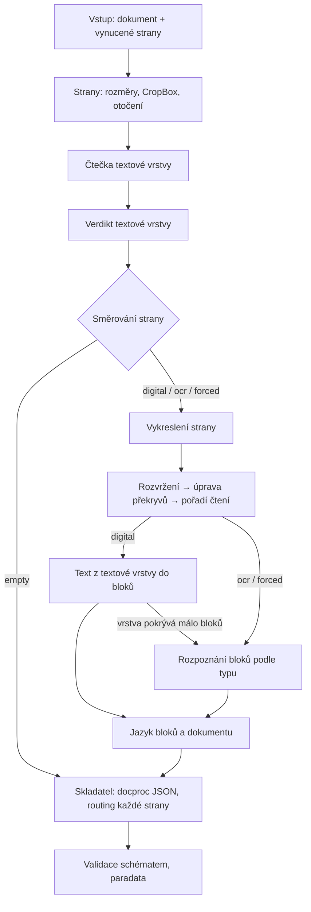

# Otevřená služba ATR: architektura a stav

Stav k 17. 11. 2026. Zadání: [aiscr-atr#2](https://github.com/ARUP-CAS/aiscr-atr/issues/2),
kontrakt výstupu: [aiscr-docs-pipeline#17](https://github.com/ARUP-CAS/aiscr-docs-pipeline/issues/17).

## 1. Cíl a zásady

- **Jeden vstup, jeden výstup.** Jakýkoli dokument (born-digital PDF, sken, smíšené PDF, obrázek) projde stejným rozhraním a vrátí `atr/docproc-json`.
- **Vyměnitelné komponenty.** Každá část má pevné rozhraní (port) a aspoň jednu implementaci (adaptér). Výměna implementace je změna konfigurace, ne kódu potrubí.
- **Každá část samostatně.** Komponenta má vlastní testy; potrubí je spojuje až nakonec.
- **Jen otevřené nástroje.** Kód i váhy s licencí MIT, Apache-2.0 nebo BSD. Nic se nepřebírá z proprietárních řešení.
- **Žádná pravidla na míru dokumentům.** Co model neumí, řeší lepší model, ne ruční detekce.

## 2. Potrubí



Rozvržení běží stejným modelem na textových i skenovaných stranách. Liší se jen zdroj textu
v bloku: textová vrstva, nebo rozpoznání.

## 3. Porty a adaptéry

Potrubí (`atr/pipeline`) zná jen porty (`atr/ports`). Adaptér se hlásí jménem do registru
a vybírá se v `config/pipeline.yaml`.

| Port | Dotaz → odpověď | Adaptéry | Kde běží |
|---|---|---|---|
| `page_source` | soubor → strany s rozměry (CropBox, `/Rotate`, `UserUnit`; obrázky s EXIF orientací a DPI) | `pdfium` | v procesu |
| `renderer` | strana, DPI → obrázek | `pdfium` | v procesu |
| `text_layer` | strana → slova a řádky s polohou, neviditelný text, pokrytí obrázky | `pdfium` | v procesu |
| `text_layer_judge` | textová vrstva → `digital`, `garbled`, `ocr`, `none` | `rules` | v procesu |
| `router` | verdikt, vynucené strany → trasa `digital`, `ocr`, `forced`, `empty` s důvodem | `rules` | v procesu |
| `layout` | obrázek strany → bloky (typ, poloha, jistota, pořadí) | `http` | kontejner s modelem |
| `layout_refiner` (nepovinný) | bloky → bloky bez vnořených duplikátů a překryvů | `overlaps` | v procesu |
| `reading_order` (nepovinný) | bloky → pořadí čtení | `model`, `xycut` | v procesu |
| `text_assigner` | slova textové vrstvy + bloky → text bloku a změřené řádky | `overlap` | v procesu |
| rozpoznávače (`recognizers`) | výřez bloku → text, tabulka, vzorec | `openai` (vLLM, llama.cpp) | kontejner s modelem |
| `language` (nepovinný) | text → jazyk | `lingua` | v procesu |
| `page_classifier` (nepovinný) | obrázek strany → kategorie | zatím žádný | – |
| `assembler` | strany, bloky, trasy → `atr/docproc-json` | `docproc` | v procesu |

Pro testy a vývoj bez PDF a GPU má každý port adaptér `fake`.

Rozpoznávač se volí podle typu bloku (tabulka `recognize` v konfiguraci). Typ bez rozpoznávače
je ve výstupu jen typem a polohou: obrázky (`figure`) a ruční písmo (`handwriting`), které
zatím žádný model nečte spolehlivě.

Rozhraní kontejnerů s modely: [`model-services.md`](model-services.md). Rozhraní služby:
[`openapi.json`](openapi.json).

## 4. Rozložení repozitáře

```
aiscr-atr/
├── docker-compose.yml          # atr-api + layout; OCR v profilech gpu, alt, vulkan, vulkan-alt
├── config/pipeline.yaml        # adaptér na každém portu, typ bloku → rozpoznávač
├── atr/                        # služba (CPU)
│   ├── api/                    # /convert, /info, /health
│   ├── pipeline/               # tok potrubí; zná jen porty
│   ├── ports/                  # rozhraní, datové typy, chyby
│   ├── adapters/               # složka na port (pdfium sdílí dokument, proto jedna složka)
│   ├── schema/                 # návrh schématu atr/docproc-json
│   ├── paradata.py, validation.py, render_utils.py
│   └── tests/
├── models/layout-ppdoclayoutv3/  # služba rozvržení (ONNX Runtime na CPU, PyTorch pro GPU)
├── training/layout/            # datová sada a dotrénování rozvržení (ArchaeoDocLayout)
├── scripts/                    # vyhodnocení, export OpenAPI, stažení GGUF
├── samples/                    # generátor syntetické testovací sady
└── docs/
```

## 5. Docker compose

| Služba | Obsah | Kdy |
|---|---|---|
| `atr-api` | potrubí a adaptéry v procesu | vždy |
| `layout` | PP-DocLayoutV3, ONNX Runtime na CPU | vždy |
| `ocr-text` | PaddleOCR-VL-1.6 za vLLM (NVIDIA) | profil `gpu` |
| `ocr-alt` | GLM-OCR za vLLM (NVIDIA) | profil `alt` |
| `ocr-text-vulkan`, `ocr-alt-vulkan` | tytéž modely přes llama.cpp (AMD, Intel) | profily `vulkan`, `vulkan-alt` |

Adresy služeb jdou měnit proměnnými prostředí (`LAYOUT_URL`, `OCR_TEXT_URL`, `OCR_ALT_URL`).

## 6. Stav

### Hotovo a ověřeno

- Čtení PDF a obrázků, souřadnice na zobrazené straně (testy na otočených a oříznutých stranách, `UserUnit`).
- Verdikt textové vrstvy včetně starší OCR vrstvy a nekvalitního textu; neúplná vrstva jde na OCR.
- Rozvržení PP-DocLayoutV3 (ONNX, asi 0,6 s na stranu na CPU), úprava překryvů, pořadí čtení.
- Rozpoznání bloků podle typu přes llama.cpp na AMD (PaddleOCR-VL-1.6, GLM-OCR).
- Jazyk bloků a dokumentu, paradata (RO-Crate Process Run Crate), validace výstupu návrhem schématu.
- Chybový model: 400, 413, 422 (trvalé selhání), 503 (dočasné), 500 (neplatný výstup).
- Dotrénované rozvržení se třídou `handwriting`: [`aiscr/ArchaeoDocLayout`](https://huggingface.co/aiscr/ArchaeoDocLayout)
  (zatím soukromé), postup a výsledky v [`training/layout/README.md`](../training/layout/README.md).

### Neověřeno

- OCR za vLLM na NVIDIA (profily `gpu`, `alt`) a připnutá verze obrazu vLLM (`VLLM_IMAGE`).
- Prahy verdiktu textové vrstvy na skutečně poškozených PDF z AMČR (nastavené podle syntetických vzorků a 498 stran interních PDF).
- CI na GitHubu (poprvé poběží po prvním push).

### Čeká na data nebo rozhodnutí

| Co | Na co čeká |
|---|---|
| normativní schéma výstupu | [aiscr-docs-pipeline#17](https://github.com/ARUP-CAS/aiscr-docs-pipeline/issues/17); v repozitáři je návrh |
| výběr OCR modelu (PaddleOCR-VL, GLM-OCR) | strany s ověřeným přepisem; vzorek AMČR má jen anotace oblastí |
| vyhodnocení pořadí čtení (`model` proti `xycut`) | anotace se skutečně seřazenými oblastmi |
| čtení ručního písma | model, který ho přečte; zatím se jen označuje |
| ArchaeoDocLayout ve výchozím compose | zveřejnění repozitáře modelu |
| klasifikace stran (`ufal/vit-historical-page` z ATRIUM) | kontejner a adaptér; port je připravený |
| kancelářské formáty (DOCX, ODT) | rozhodnutí, zda je má ATR brát |
| shoda s digital-convert (ÚFAL) | oba nástroje mají vydávat stejný `atr/docproc-json`; srovnání v [aiscr-docs-pipeline#20](https://github.com/ARUP-CAS/aiscr-docs-pipeline/issues/20) |

## 7. Měření

- **Rozvržení na 100 anotovaných stranách AMČR** (`scripts/eval_layout_segmonto.py`): původní
  PP-DocLayoutV3 pokrývá 90 % oblastí; chybí hlavně rukopisné doplňky (33 %) a záhlaví/zápatí (34 %).
  ArchaeoDocLayout na 38 stranách mimo trénink: 99 %, rukopisné doplňky 81 %, záhlaví/zápatí 100 %.
- **Pořadí čtení** (`scripts/eval_reading_order.py`): pořadí oblastí v anotacích odpovídá poloze
  jen na τ = 0,55, anotátoři ho neřadili; měření proto nic neříká.
- **OCR**: srovnání obou modelů jen na jednotlivých stranách; PaddleOCR-VL lépe drží českou
  diakritiku ve strojopisu, krátké ruční přípisy nečte dobře žádný z nich.

## 8. Podklady k volbě řešení

- **xberg 1.3.9** (pokus): směrování stran a text s polohou fungují; oblasti rozvržení nevrací,
  PP-DocLayout-V3 nejde zvolit, souřadnice nejsou jednotné. Proto vlastní komponenty.
- **Průzkum hotových řešení** (11/2026): žádné nesplňuje vše. Nejblíž je PaddleOCR-VL-1.6
  (Apache-2.0; rozvržení a rozpoznání po blocích, bez textové vrstvy) a Docling (MIT; textová
  vrstva a rozvržení, bez rozpoznání po blocích přes VLM).
- **Detekce jazyka**: lingua-py (Apache-2.0) místo fastText, jehož aktuální model pro určení
  jazyka má licenci jen pro nekomerční užití. Ze stejného důvodu není použit LayoutReader pro pořadí čtení.
- **Trénink rozvržení**: oficiální cesta přes PaddleX neběží na AMD ani ARM, proto vlastní
  trénink v PyTorch nad implementací z transformers.
